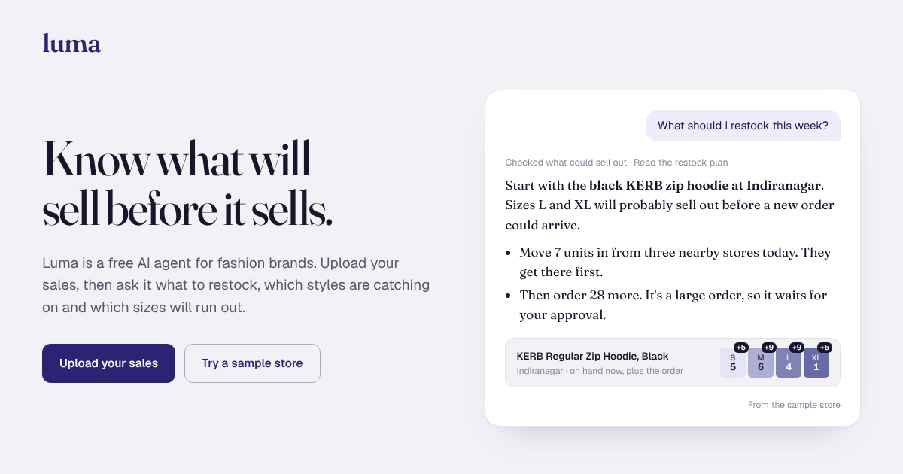
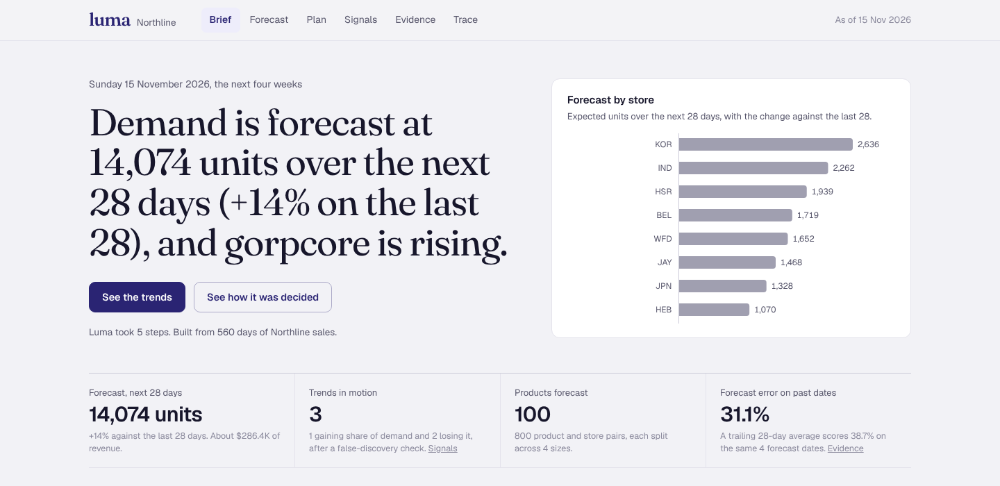
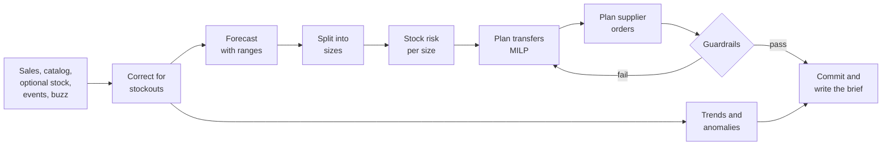
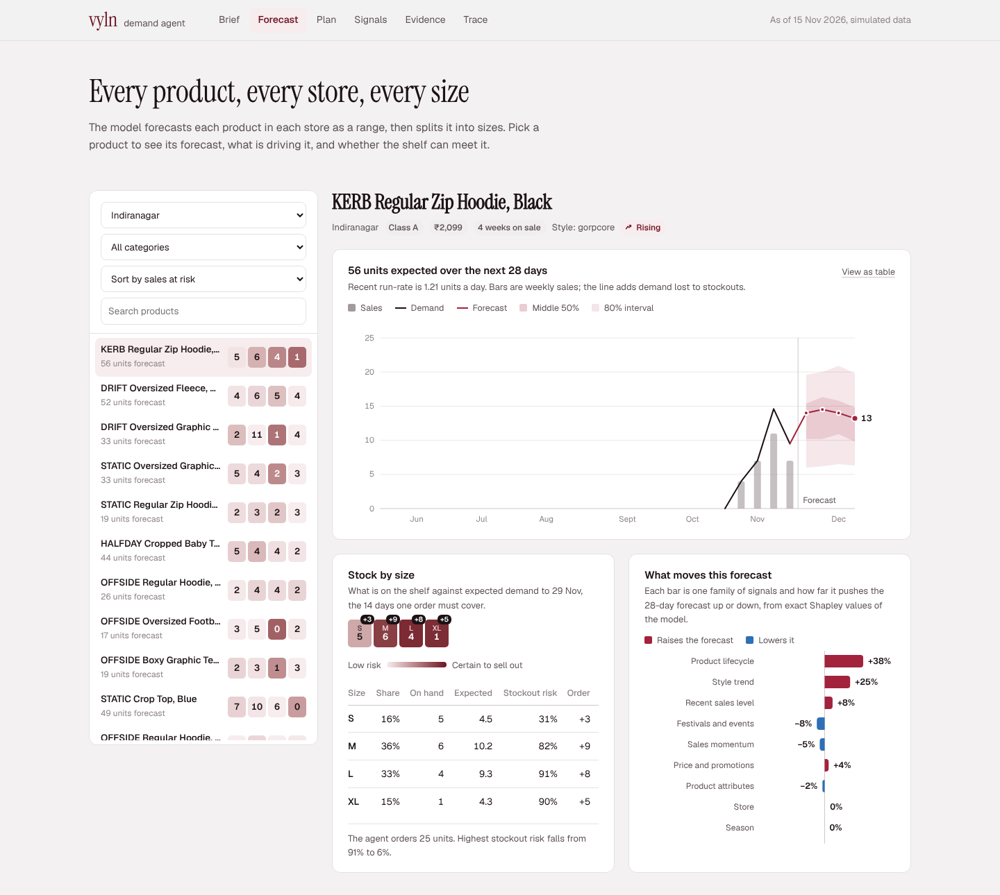
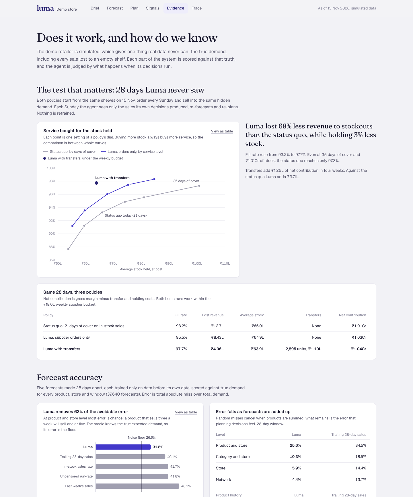

# luma

An open-source agent that forecasts fashion demand for every product, store and size, finds the trends that are starting to move, and turns both into the week's stock decisions. Point it at a sales export and a catalog.

**Try it: [luma-forecast.vercel.app](https://luma-forecast.vercel.app)**, with a sample store or your own sales. Free, no account.

[Methods](docs/methods.md) · [Design notes](docs/design.md)



## Why it exists

**The problem.** A fashion brand has to decide what to stock before it knows what will sell. Products live for weeks, trends move faster than supplier lead times, and stock is held by size. Sales data hides the worst mistakes, because a size that sold out records no demand at all. Most brands plan from last month's sales in a spreadsheet, which is late on every trend and blind to every stockout.

**The approach.** Luma reads the sales history, corrects it for stockouts, and forecasts each product in each store as a range, not a single number. It tests every catalog attribute (style, colour, fit, fabric, whatever the catalog holds) for a share of demand that is rising or fading beyond chance. An agent then works through the result with tools: it checks anomalies, measures stockout risk by size, drafts supplier orders within a budget, proposes transfers between stores, and commits a plan only when it passes every check.

**Why that solves it.** Each decision is tied to a measured probability, so stock goes where demand is both likely and uncertain. Each forecast is replayed on past dates and scored, so a brand can see how far to trust it before acting. Each step the agent takes is recorded, so a person can audit the plan and overrule it.

## Use the website

Open [luma-forecast.vercel.app](https://luma-forecast.vercel.app). Try the sample store, or upload your own sales: Shopify's orders export (plus the products export, if you have it) works as it is, and so does any CSV with a date, product, size and quantity on each row. Luma analyses the files in about a minute, then you ask it questions in plain words.

How the site is built:

- **Analysis.** The browser compresses the files and sends them to a Python function ([`api/analyze.py`](api/analyze.py)). It runs the same pipeline as the command line, with lighter settings (three replayed dates and 70% of the trees), and returns the analysis. Nothing is written to disk or kept.
- **Chat.** The analysis stays in the browser. Each question goes to [`api/chat.ts`](api/chat.ts), which adds a fixed system prompt and eleven tool definitions and calls Claude. When Claude asks for a tool, the browser runs it on the analysis ([`web/src/agent/tools.ts`](web/src/agent/tools.ts)) and sends back the result, until Claude answers. The API key never reaches the browser, and a brand's data reaches Claude only as the small tool results it asks for.
- **Limits.** Up to 2,000 product and store pairs and 4.3 MB of compressed upload per analysis. History is capped at two years, and shortened for large catalogs so that an analysis finishes within the 300-second function limit (400 pairs over a year takes about 85 seconds). Chat is rate-limited per visitor.

### Deploy your own copy

Import the repository into Vercel; `vercel.json` sets up the build and both functions. Add an `ANTHROPIC_API_KEY` environment variable, and optionally `LUMA_MODEL` (default `claude-sonnet-5-5`). Set a monthly spend limit in the Anthropic console, because anyone with the link can chat.

## Quick start

Requires Python 3.11 or newer.

```bash
git clone https://github.com/vivaansheth5/vyln-demand-agent.git luma
cd luma
pip install -e ".[dev]"

luma run --small     # the demo on a tiny simulated retailer, a few seconds
luma run             # the full demo, about 2.5 minutes on 2 cores
luma trends          # the trends found in the last run
luma trace           # the agent's last run, step by step
```

## Use your own data

```bash
luma init my-brand                       # starter CSV files and a column guide
# fill in my-brand/sales.csv and my-brand/catalog.csv
luma run --data my-brand --brand "Northline" --currency USD
luma serve                               # dashboard at http://127.0.0.1:8000 (build it first, see below)
```

Two tables are required. Files can be CSV or Parquet, and column names are matched loosely (`sku`, `product_id` and `item_id` all read as `sku_id`; `qty` and `quantity` read as `units_sold`).

| Table | Required columns | Optional columns |
|---|---|---|
| `sales` | date, sku_id, units_sold | store_id, size, stock_open, stock_close |
| `catalog` | sku_id, price | name, category, unit_cost, launch_date, and any attribute columns |

Every text column in the catalog with 2 to 40 distinct values is treated as a product attribute. Attributes feed the forecaster, and each one is tested for trends, so a `fabric` or `collection` column is all it takes to track fabric or collection trends.

What you add decides what you get:

| You supply | Luma gives you |
|---|---|
| Sales and a catalog | Forecasts with calibrated ranges for 1 to 4 weeks, size curves, trends on every attribute, anomalies |
| + `events` (sales, festivals, drops, with dates) | Forecasts that see a planned event coming |
| + `stock` (units on hand by product, store and size) | Stockout risk per size, a budgeted supplier order plan, slow-stock list |
| + `stores` with coordinates | Transfers between stores, chosen by an optimiser |
| + `stock_open` and `stock_close` in sales | Demand corrected for stockouts, so the model stops learning from empty shelves |
| + `buzz` (a search or social interest index per style) | Trends called before sales move |
| + `discounts`, `weather` | Planned markdowns and weather in the forecast |

`luma init` writes the two required tables, a full column guide, and an example of each optional table in `optional/`; move one up beside `sales.csv` once you have filled it in. `luma simulate --csv --out data` writes the demo retailer in the same format. [`examples/own_data.py`](examples/own_data.py) does the same run from Python.



A history needs at least 110 days. About 20 weeks are needed before Luma can replay an earlier forecast and report its own accuracy.

## Ask it questions

`luma run` saves the trained state, so questions need no retraining:

```bash
pip install -e ".[llm]"
export ANTHROPIC_API_KEY=...
luma ask "Which styles are rising, and are we stocked for them?"
luma ask "What would the order plan look like on half the budget?" --show-steps
```

Claude answers by calling the same tools the planner uses. It can draft a what-if plan and cannot commit one. `luma run --mode llm` lets Claude drive the weekly run itself, under the same guardrails.

## Results

There are two kinds of evidence, and they answer different questions.

### On the simulated demo, scored against the truth

The demo is a simulated retailer: 8 stores, 100 products in 4 sizes, 80 weeks of history, 964,168 sales rows. A simulator knows the true demand, including every sale lost to an empty shelf, so each part of the system can be scored against it.

**The test that matters: 28 days Luma never saw.** Luma and a status-quo policy start from the same shelves, order every Sunday, and sell into the same hidden demand. Each Sunday Luma sees only the sales its own decisions produced, re-forecasts and re-plans.

| Same 28 days | Fill rate | Revenue lost to stockouts | Average stock held |
|---|---:|---:|---:|
| Status quo (21 days of cover on in-stock sales) | 93.2% | ₹12.74L | ₹66.0L |
| Luma, supplier orders only | 95.5% | ₹8.43L | ₹64.9L |
| **Luma with transfers** | **97.7%** | **₹4.06L** | **₹63.9L** |

Luma lost 68% less revenue to stockouts while holding 3% less stock. More stock does not close the gap for the status quo: at 35 days of cover and ₹100.8L of stock it reaches 97.3%.

| Component | Measured against simulator truth |
|---|---|
| Forecast error, product and store level | 31.8%, against 40.1% for a trailing 28-day average. Pure chance accounts for 26.6%, so Luma removes 62% of the avoidable error |
| Forecast error, store level, 28 days | 5.9%, against 14.4% |
| Products under 4 weeks old | 31.8%, against 53.4% |
| Forecast ranges | A stated P90 has 90.6% of outcomes below it; a stated P95 has 95.1% |
| Demand hidden by stockouts | Raw sales understate demand by 7.7%. Uncensoring recovers 99% of it |
| Size mix | Error of 3.2 points per size, against 5.1 unpooled (4.4 against 10.5 where data is thin) |
| Trends | Called one style emerging on the as-of date; its true pull rose 82% over the next four weeks |
| Anomalies | 7 of 9 store outages found at 88% precision; 8 of 12 viral product spikes at 67% |

Error is total absolute miss over total demand, across 37,640 forecasts made on five dates, each by a model trained only on data before its own date. All figures are from the run committed in `web/public/data/dashboard.json` (seed 7).

### On a plain export, scored against what was sold next

The same history was then stripped down to what a brand would export, order lines and a catalog with loosely named columns, and run through `luma run --data`. There is no true demand here, so forecasts are scored against actual sales on four earlier dates (29,640 forecasts).

| Data supplied | Error, product and store | Error, store level, 28 days | Outcomes under a stated P90 |
|---|---:|---:|---:|
| Trailing 28-day average, for reference | 38.7% | 15.1% | |
| Sales and catalog | 34.6% | 16.5% | 86.9% |
| Sales, catalog and an events table | 31.1% | 7.8% | 90.8% |

With sales alone Luma is better product by product and slightly worse on the store total, because one of the four test windows held a festival nobody had told it about. Adding the events table fixes that. If you plan sales, drops or holidays, give Luma the dates.

These numbers describe a simulated history. See [Limits](#limits).

## What the agent does



The agent works through nine typed tools: `network_overview`, `scan_anomalies`, `scan_trends`, `scan_stockout_risk`, `explain_forecast`, `find_overstock`, `draft_plan`, `check_guardrails` and `commit_plan`. Two planners drive them: a deterministic one that needs no API key, and Claude through the Messages API. `commit_plan` refuses any draft that fails a guardrail, so either planner has to repair the plan first.

On the committed demo run the agent took 13 steps. It drafted a plan that met every service target, found it cost ₹19.9L against an ₹18.0L budget, redrafted under the budget by cutting the units least likely to sell, passed every blocking check, and committed: 2,555 units ordered on 505 lines (24 queued for a person), 531 units moved between stores on 26 lanes, and ₹12.5L of sales protected over the next 14 days.

When the data has no stock table the agent stops after forecasts, trends and anomalies, and says what to add. When one young product accounts for most of a large change in the forecast, the brief names it and tells the reader to check it.


## How each part works

Each part exists because a simpler version fails in a specific way.

### 1. Uncensoring: sales are not demand

**Problem.** When a size sells out, the till records what was on the shelf, not what customers wanted. A model trained on sales under-forecasts its best sellers, which under-orders them, which causes the next stockout.

**Approach.** Every size-day that ended with zero stock is treated as a lower bound. Its expected demand is the conditional mean of a Poisson variable given that bound, with a rate taken from the size's own in-stock days and the store's traffic that day.

**Why it works.** The correction uses only what the data supports, and it is unbiased in total: on the demo, estimated demand is within 0.1% of true demand, where raw sales were 7.7% low. It needs daily stock columns; without them Luma says so and forecasts sales.

### 2. Forecasting: one model for best sellers and three-day-old products

**Problem.** A product in one store sells a few units a week. Its own history is too thin to forecast from, and a new product has none.

**Approach.** Gradient-boosted trees (LightGBM) predict demand relative to each series' recent run-rate, over ten windows from one to four weeks. The features are ratios, so a best seller and a slow seller are the same kind of example. Each row also carries how the product sells across all stores, how its category sells in the store, where its attributes are heading, and what the calendar and discount plan hold for the target window.

**Why it works.** The model learns shared structure (what a festival does to hoodies, how a product behaves in week two) from every series at once and applies it to each. On the demo, error on products under four weeks old falls from 53.4% to 31.8%.

### 3. Calibrated ranges: a P90 has to mean 90%

**Problem.** Stock decisions depend on the top of the forecast range, not its middle. Quantile models give ranges, but nothing forces a stated 90% to cover 90% of outcomes.

**Approach.** The pipeline replays earlier forecast dates the way production would have lived them. Once each forecast's 28 days have passed, its misses are recorded, and every later forecast's quantiles are shifted by the amount that would have corrected the spread (conformal calibration).

**Why it works.** The correction comes from real out-of-sample forecasts, and the result is reported on the Evidence page of every run, for your data as well as the demo.

### 4. Size curves: stock is held by size

**Problem.** A product's raw size mix in one store is mostly noise, and it is biased: a size that sold out looks unpopular.

**Approach.** Shares are counted only on days when every size was on the shelf. Each curve is a Dirichlet-multinomial posterior whose prior combines the product's curve across all stores with the store's curve for the category, with the prior strength fitted by maximum likelihood. The product forecast is then split by size through a property of the negative binomial that keeps the whole distribution, not just the mean.

**Why it works.** A new store or product starts from a sensible shape and moves to its own data as evidence arrives. Error halves where data is thin. Sizes are whatever the data holds: S to XL, waist sizes, or one size.

### 5. Trends: separating a trend from two good weeks

**Problem.** With eight weekly points a rising line is easy to imagine, outerwear rises every winter regardless of style, and testing dozens of attribute values guarantees false alarms.

**Approach.** Share of demand is measured inside each category so seasonality cancels. A Mann-Kendall test asks whether the movement is more consistent than chance, a Theil-Sen slope gives a rate one odd week cannot bend, and Benjamini-Hochberg adjustment holds false discoveries to 10% across every value of every attribute. An optional buzz index marks a value as emerging before its sales have moved.

**Why it works.** A brand gets a short list it can act on. On the demo the detector called one style emerging on buzz alone, and in the simulator's hidden future its pull rose 82% over the next four weeks.

### 6. Anomalies: flags that come with a cause

**Problem.** A flag on every festival is noise, and an unexplained spike left in the data inflates a run-rate and the orders built on it.

**Approach.** The total is monitored against its own recent pattern, each store against the total, and each product against its category, so one cause is reported once and at the level where it happened. Every flag is checked against the calendar, the discount plan and the weather. What survives is labelled unexplained.

**Why it works.** A person reviews a short list. Orders that depend on an unexplained spike are routed to that person instead of being approved automatically.

### 7. Transfers: the fastest fix is stock you already own

**Problem.** A supplier order takes a lead time to land. Until then a sale can only be saved by moving a unit from a store that will not miss it, and a trip has a fixed cost and a capacity.

**Approach.** A mixed-integer programme chooses which lanes to open and how many units of each product and size to send. Moving a unit is worth its margin times the difference between its chance of selling at the receiver and at the donor, less handling cost. The programme is solved with HiGHS, to proven optimality for the committed demo plan.

**Why it works.** Value is counted unit by unit with diminishing returns, so donors keep what they are likely to sell. In the 28-day test transfers added ₹1.25L of net contribution after their own cost.

### 8. Supplier orders: a fixed budget spent in the right order

**Problem.** A flat "days of cover" rule ignores uncertainty and treats a fast seller like a slow one, and any rule breaks when the budget cannot fund it.

**Approach.** Each size is ordered up to the demand quantile at its service level (95%, 90% or 80% by share of store revenue) over the interval one order must cover. Under a binding budget, units are bought in order of expected margin for their cost.

**Why it works.** Safety stock goes where demand is uncertain and valuable, and a budget cut removes the units least likely to sell first.

### 9. The agent: decisions that can be audited

**Problem.** A pipeline that emits orders cannot explain itself, and a language model that emits orders cannot be trusted with a budget.

**Approach.** Typed tools read the state, draft a plan, check it and commit it. Every number comes from a tool, hard limits are enforced in code and not by instruction, and every step is recorded with its reasoning, call and result.

**Why it works.** The plan can be traced from headline to tool call, and a planner of either kind cannot commit a plan that breaks a limit.

Formulas and parameters are in [docs/methods.md](docs/methods.md).

## Report

The website's Report tab is the full dashboard. To run it locally on your own run:

```bash
cp artifacts/dashboard.json web/public/data/     # your run, or keep the committed demo
cd web && npm ci && npm run build && cd ..
luma serve                                       # http://127.0.0.1:8000
```

The dashboard is a static site that reads one file, `data/dashboard.json`. It adapts to the data: the plan, the map, transfers and the stockout views appear when the run had the tables behind them. `npm run dev` in `web/` starts a development server, and `npm run build:single` writes one self-contained HTML file with the data embedded.

`web/public/data/dashboard.json` is the sample store the website opens with; replace it to publish your own run. The `Deploy dashboard` workflow publishes the site to GitHub Pages without the upload and chat functions.

| | |
|---|---|
|  |  |
|  |  |

### API

`luma serve` also exposes JSON: `/api/overview`, `/api/forecast/{store}/{sku_id}`, `/api/risks`, `/api/plan`, `/api/trends`, `/api/anomalies`, `/api/evaluation`, `/api/agent`. With `--live` the server holds the demo's trained model in memory, and `POST /api/agent/run {"budget": 1500000}` re-runs the agent under a new budget in seconds, without retraining.

## Layout

```
src/luma/
  data/         table loader, starter templates, and the Panel every model reads
  models/       uncensoring, LightGBM forecaster, calibration, size curves
  features/     leakage-safe feature engineering
  signals/      trend and anomaly detection
  inventory/    stock engine, risk, supplier orders, transfer MILP
  agent/        tools, guardrails, rules planner, Claude planner, questions
  evaluation/   backtests, and closed-loop policy evaluation on the demo
  sim/          the simulated demo retailer
  api/          FastAPI service for local use
  web.py        the website's analysis entry point
  data/shopify.py  reads Shopify's order and product exports
api/            Vercel functions: analyze.py (Python) and chat.ts (Claude relay)
web/            React and TypeScript website: home, upload, chat and the report
tests/          60 tests: leakage, conservation, calibration, feasibility, own data, Shopify exports, agent behaviour
docs/           methods and design notes
```

## Limits

- The headline results come from one simulated retailer whose structure resembles what the features can express. Real demand will be less tidy and the gains smaller. Luma has not yet been run on a real brand's data.
- On your own data there is no true demand to score against, and no closed-loop test. Luma reports forecast accuracy on past dates; it does not measure the value of its stock decisions.
- With a few dozen products the model has little to learn from, and one fast-growing product can dominate the forecast. The brief names it when that happens. Check the Evidence page before trusting a small run.
- Without an events table Luma cannot see a sale or a festival coming.
- Lead time is one number for every product. Minimum order quantities and returns are not modelled.
- The 80% interval covers about 76% of outcomes on the demo, because low quantiles run high on slow sellers. Upper quantiles, which drive stock decisions, are on target.
- Arrays are dense over days, stores, products and sizes. Luma has been run at 800 product and store pairs; a very large catalog will need a sparse layout first.
- The website's chat runs on the live Claude API. The command-line Claude modes (`luma run --mode llm` and `luma ask`) are tested only against a scripted client that follows the Messages API shape.
