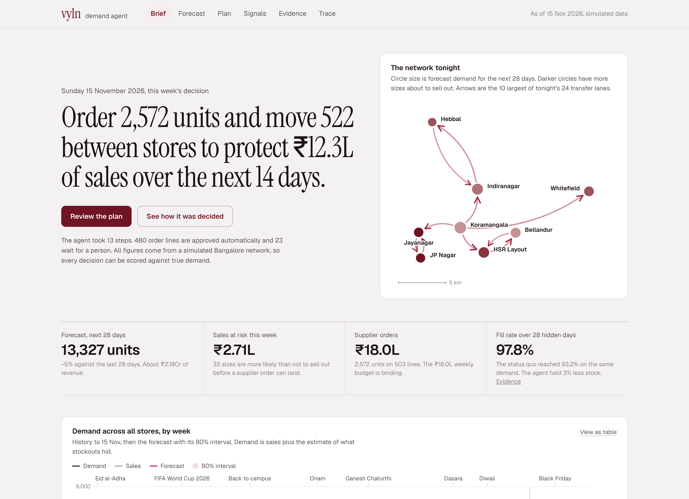
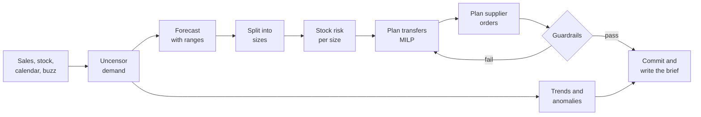
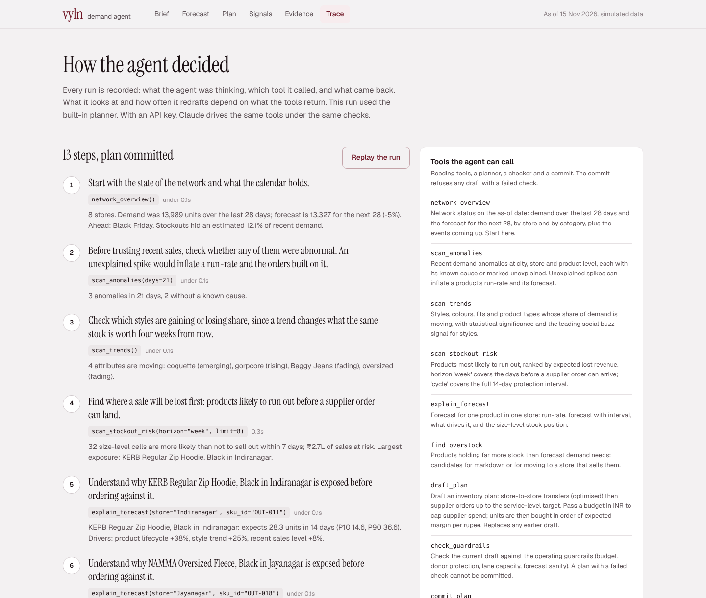
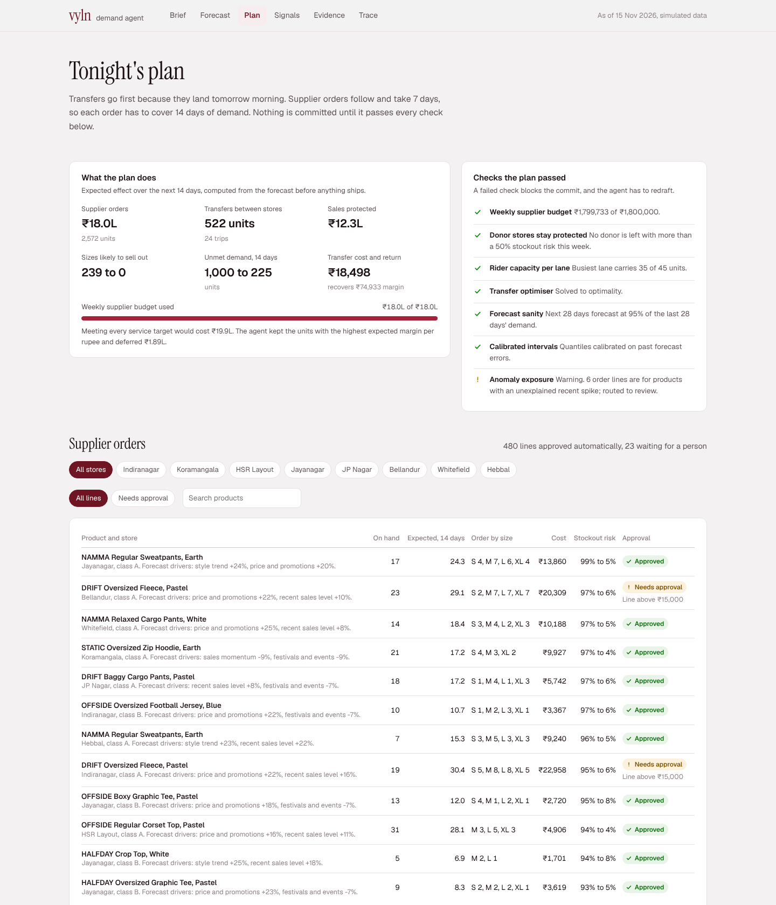
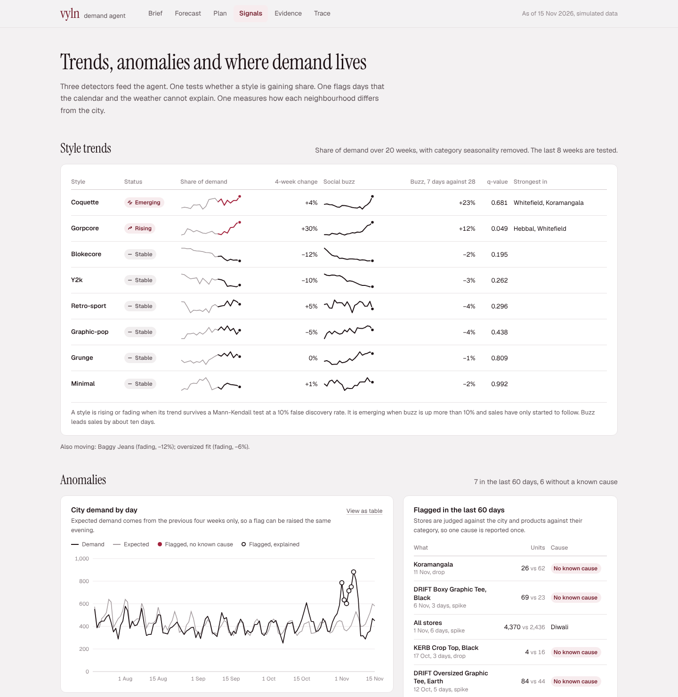

# vyln demand agent

An autonomous agent that forecasts fashion demand for every product, store and size, and turns the forecast into the week's inventory decisions: what to order from suppliers, what to move between stores tonight, and which lines need a person's approval.

Built for [VYLN](#why-this-exists), 60-minute fashion delivery in Bangalore.



## Results

VYLN has not traded yet, so the agent runs on a simulated Bangalore network: 8 dark stores, 100 products in 4 sizes, 80 weeks of history, 964,168 sales rows. A simulator has one advantage over real data. It knows the true demand, including every sale lost to an empty shelf, so each part of the system can be scored against the truth.

**The test that matters: 28 days the agent never saw.** The agent and a status-quo policy start from the same shelves, order every Sunday, and sell into the same hidden demand. Each Sunday the agent sees only the sales its own decisions produced, re-forecasts and re-plans.

| Same 28 days | Fill rate | Revenue lost to stockouts | Average stock held |
|---|---:|---:|---:|
| Status quo (21 days of cover on in-stock sales) | 93.2% | ₹12.74L | ₹66.0L |
| Agent, supplier orders only | 95.6% | ₹8.30L | ₹64.9L |
| **Agent with transfers** | **97.8%** | **₹3.98L** | **₹63.9L** |

The agent lost 69% less revenue to stockouts while holding 3% less stock. More stock does not close the gap for the status quo: at 35 days of cover and ₹100.8L of stock it reaches 97.3%.

| Component | Measured against simulator truth |
|---|---|
| Forecast error, product and store level | 31.8%, against 40.1% for a trailing 28-day average. Pure chance accounts for 26.6%, so the agent removes 61% of the avoidable error |
| Forecast error, store level, 28 days | 6.4%, against 14.4% |
| Products under 4 weeks old | 32.4%, against 53.4% |
| Forecast ranges | A stated P90 has 90.3% of outcomes below it; a stated P95 has 95.0% |
| Demand hidden by stockouts | Raw sales understate demand by 7.7%. Uncensoring recovers 99% of it |
| Size mix | Error of 3.2 points per size, against 5.1 unpooled (4.4 against 10.5 where data is thin) |
| Anomalies | 7 of 9 store outages found at 88% precision; 8 of 12 viral product spikes at 67% |

Error is total absolute miss over total demand, across 37,640 forecasts made on five dates, each by a model trained only on data before its own date. All figures are from the run committed in `web/public/data/dashboard.json` (seed 7). They describe a simulated world; see [Limits](#limits).

## What the agent does each week



On the as-of date of the committed run the agent took 13 steps. It drafted a plan that met every service target, found it cost ₹19.9L against an ₹18.0L weekly budget, redrafted under the budget by cutting the units least likely to sell, passed every blocking check, and committed: 2,572 units ordered on 503 lines (23 queued for a person), 522 units moved between stores on 24 rider trips, and ₹12.3L of sales protected over the next 14 days.



## How each part works

Each part exists because a simpler version fails in a specific way.

### 1. Uncensoring: sales are not demand

**Problem.** When a size sells out, the till records what was on the shelf, not what customers wanted. A model trained on sales under-forecasts its best sellers, which under-orders them, which causes the next stockout.

**Approach.** Every cell-day that ended with zero stock is treated as a lower bound. Its expected demand is the conditional mean of a Poisson variable given that bound, with a rate taken from the cell's own in-stock days and the store's traffic that day.

**Why it works.** The correction uses only what the data supports, and it is unbiased in total: after correction, estimated demand is within 0.1% of true demand, where raw sales were 7.7% low.

### 2. Forecasting: one model for best sellers and three-day-old products

**Problem.** A product in one store sells a few units a week. Its own history is too thin to forecast from, and a new product has none.

**Approach.** Gradient-boosted trees (LightGBM) predict demand relative to each series' recent run-rate, over ten windows from one to four weeks. The 68 features are ratios, so a best seller and a slow seller are the same kind of example. Each row also carries how the product sells across the city, how its category sells in the store, where its style is heading, and what the calendar and discount plan hold for the target window.

**Why it works.** The model learns shared structure (what Diwali does to hoodies, how a product behaves in week two) from all 800 series at once and applies it to each. Error on products under four weeks old falls from 53.4% to 32.4%.

### 3. Calibrated ranges: a P90 has to mean 90%

**Problem.** Stock decisions depend on the top of the forecast range, not its middle. Quantile models give ranges, but nothing forces a stated 90% to cover 90% of outcomes.

**Approach.** The pipeline replays four earlier forecast dates the way production would have lived them. Once each forecast's 28 days have passed, its misses are recorded, and every later forecast's quantiles are shifted by the amount that would have corrected the spread (conformal calibration).

**Why it works.** The correction comes from real out-of-sample forecasts, and it is checked against truth: the calibrated P90 has 90.3% of outcomes below it, and the P95 has 95.0%.

### 4. Size curves: stock is held by size

**Problem.** A pair's raw size mix is mostly noise, and it is biased: a size that sold out looks unpopular.

**Approach.** Shares are counted only on days when every size was on the shelf. Each curve is a Dirichlet-multinomial posterior whose prior combines the product's city-wide curve with the store's curve for the category, with the prior strength fitted by maximum likelihood. The product forecast is then split by size through a property of the negative binomial that keeps the whole distribution, not just the mean.

**Why it works.** A new store or product starts from a sensible shape and moves to its own data as evidence arrives. Error halves where data is thin.

### 5. Trends: separating a trend from two good weeks

**Problem.** With eight weekly points a rising line is easy to imagine, outerwear rises every winter regardless of style, and testing dozens of attributes guarantees false alarms.

**Approach.** Share of demand is measured inside each category so seasonality cancels. A Mann-Kendall test asks whether the movement is more consistent than chance, a Theil-Sen slope gives a rate one odd week cannot bend, and Benjamini-Hochberg adjustment holds false discoveries to 10%. A social buzz index, which leads sales by about ten days, marks styles as emerging before their sales have moved.

**Why it works.** On the as-of date the detector called coquette emerging on buzz alone. In the simulator's hidden future its pull rose 82% over the next four weeks.

### 6. Anomalies: flags that come with a cause

**Problem.** A flag on every festival is noise, and an unexplained spike left in the data inflates a run-rate and the orders built on it.

**Approach.** The city is monitored against its own recent pattern, each store against the city, and each product against its category, so one cause is reported once and at the level where it happened. Every flag is checked against the calendar, the discount plan and the weather. What survives is labelled unexplained.

**Why it works.** A person reviews a short list. Orders that depend on an unexplained spike are routed to that person instead of being approved automatically.

### 7. Transfers: the only move that works within a day

**Problem.** A supplier order takes a week. Until it lands, a sale can only be saved by moving a unit from a store that will not miss it, and a rider trip has a fixed cost and a capacity.

**Approach.** A mixed-integer programme chooses which lanes to open and how many units of each product and size to send. Moving a unit is worth its margin times the difference between its chance of selling at the receiver and at the donor, less handling cost. The programme is solved with HiGHS, to proven optimality for the committed plan.

**Why it works.** Value is counted unit by unit with diminishing returns, so donors keep what they are likely to sell. In the 28-day test transfers added ₹1.24L of net contribution after their own cost.

### 8. Supplier orders: a fixed budget spent in the right order

**Problem.** A flat "days of cover" rule ignores uncertainty and treats a fast seller like a slow one, and any rule breaks when the budget cannot fund it.

**Approach.** Each cell is ordered up to the demand quantile at its service level (95%, 90% or 80% by share of store revenue) over the 14 days one order must cover. Under a binding budget, units are bought in order of expected margin per rupee.

**Why it works.** Safety stock goes where demand is uncertain and valuable, and a budget cut removes the units least likely to sell first.

### 9. The agent: decisions that can be audited

**Problem.** A pipeline that emits orders cannot explain itself, and a language model that emits orders cannot be trusted with a budget.

**Approach.** Nine typed tools read the state, draft a plan, check it and commit it. Two planners drive the same tools: a deterministic one that needs no API key, and Claude through the Messages API. `commit_plan` refuses any draft that fails a guardrail, so either planner has to repair the plan first. Every step is recorded with its reasoning, call and result.

**Why it works.** Numbers come only from tools, hard limits are enforced in code and not by instruction, and the full trace is on the dashboard.

Formulas and parameters are in [docs/methods.md](docs/methods.md).

## Run it

Requires Python 3.11 or newer.

```bash
git clone https://github.com/vivaansheth5/vyln-demand-agent.git
cd vyln-demand-agent
pip install -e ".[dev]"

demand-agent run            # full pipeline, about 2.5 minutes on 2 cores
demand-agent run --small    # tiny world, a few seconds
demand-agent trace          # print the agent's last run step by step
pytest                      # 40 tests, about 10 seconds
```

`demand-agent run` writes `artifacts/dashboard.json`, `forecast.parquet`, `orders.csv`, `transfers.csv` and `agent_trace.json`.

To let Claude drive the tools instead of the built-in planner:

```bash
pip install -e ".[llm]"
export ANTHROPIC_API_KEY=...
demand-agent run --mode llm
```

### Dashboard

```bash
cp artifacts/dashboard.json web/public/data/     # or keep the committed run
cd web && npm ci && npm run build && cd ..
demand-agent serve                               # http://127.0.0.1:8000
```

`npm run dev` in `web/` starts a development server. `npm run build:single` writes one self-contained HTML file with the data embedded. The `Deploy dashboard` workflow publishes the site to GitHub Pages once Pages is enabled (Settings, Pages, Source: GitHub Actions).

| | |
|---|---|
|  |  |
|  |  |

Design decisions are in [docs/design.md](docs/design.md).

### API

`demand-agent serve` also exposes JSON: `/api/overview`, `/api/forecast/{store}/{sku_id}`, `/api/risks`, `/api/plan`, `/api/trends`, `/api/anomalies`, `/api/evaluation`, `/api/agent`. With `--live` the server holds the trained model in memory, and `POST /api/agent/run {"budget": 1500000}` re-runs the agent under a new budget in seconds, without retraining.

## Use your own data

Nothing after the simulator depends on it. The pipeline reads one object, a `Panel`, built from long tables:

| Table | Columns |
|---|---|
| `sales` | date, store_id, sku_id, size, units_sold, stock_open, stock_close |
| `stores` | store_id, name, lat, lon, open_day |
| `catalog` | sku_id, name, category, subtype, style, color, fit, label, price, unit_cost, launch_day |
| `calendar` | date, dow, doy, festive, party, sale, sports, campus, payday, month_end, event |
| `discounts` | date, sku_id, discount |
| `weather` | date, tmax, tmax_normal, rain_mm |
| `buzz` | date, then one column per style |
| `stock` | store_id, sku_id, size, on_hand, inbound_d1 ... inbound_d7 |
| `meta` | start, n_days, plan_days, lead_time |

`demand-agent simulate --out data` writes an example of every table. [`examples/own_data.py`](examples/own_data.py) loads a folder of them, trains, calibrates, runs the agent and writes the plan. Category keys are set in `config.py`.

## Layout

```
src/demand_agent/
  sim/          synthetic Bangalore: stores, catalogue, calendar, weather, demand, stockouts
  data/         Panel: everything the agent may see, and its table format
  models/       uncensoring, LightGBM forecaster, calibration, size curves
  features/     leakage-safe feature engineering
  signals/      trend and anomaly detection
  inventory/    stock engine, risk, supplier orders, transfer MILP
  agent/        tools, guardrails, rules planner, Claude planner
  evaluation/   backtests against truth, closed-loop policy evaluation
  api/          FastAPI service
web/            React and TypeScript dashboard
tests/          40 tests: leakage, conservation, calibration, feasibility, agent behaviour
docs/           methods and design notes
```

## Limits

- Every result is from one simulated world whose structure resembles what the features can express. Real demand will be less tidy and the gains smaller. The value of the simulator is that it makes the method testable before there is data.
- The status quo is one reasonable rule, not a tuned competitor.
- Lead time is fixed at 7 days. Minimum order quantities and returns are not modelled.
- The 80% interval covers 76% of outcomes, because low quantiles run high on slow sellers. Upper quantiles, which drive stock decisions, are on target.
- The buzz index is simulated. A real one will be noisier.
- The Claude planner is tested against a scripted client that follows the Messages API shape. It has not yet been run against the live API.

## Why this exists

VYLN delivers fashion in 60 minutes from dark stores. The promise holds only if the right product, in the right size, is already in the right neighbourhood. Fashion makes that hard: products live for weeks, trends move faster than supplier lead times, and every sale lost to an empty shelf is invisible in the sales data. This agent is the part of the system that decides, every week, what each store should hold.
